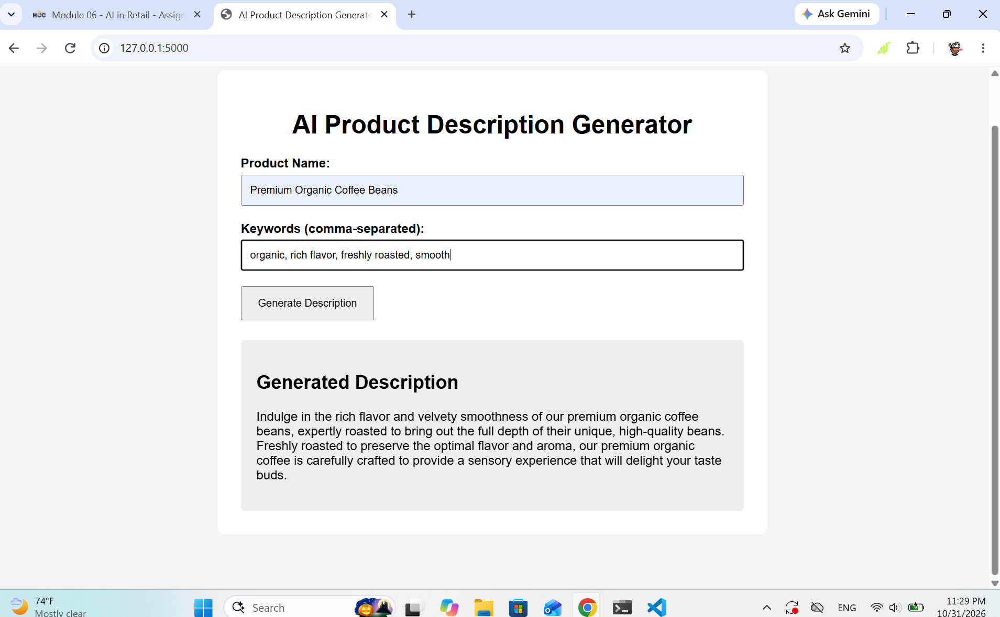
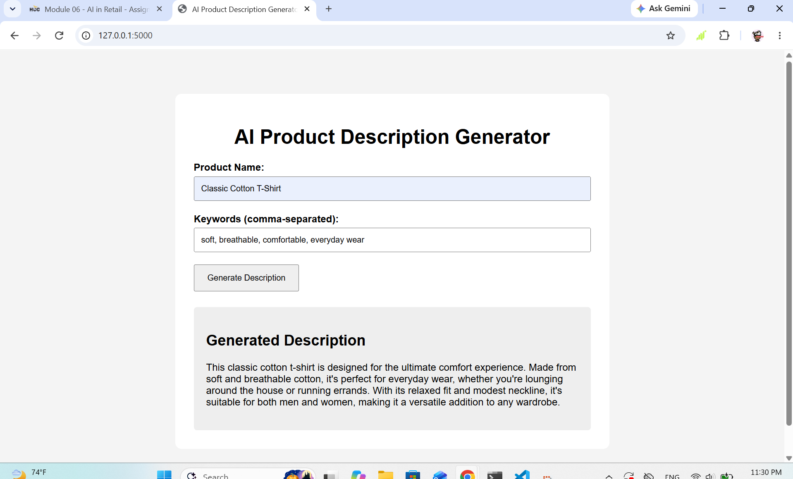
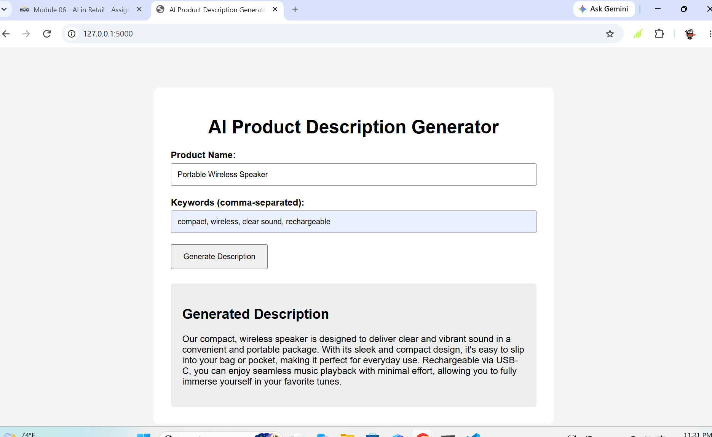

# AI Product Description Generator

A simple Flask web application that uses a local Large Language Model (LLM) through Ollama to generate product descriptions.

## Features

- Enter a product name
- Enter keywords
- Generate an AI-powered product description

## Technologies Used

- Python
- Flask
- Ollama
- llama3.2:1b

## How to Run

1. Install the required libraries:

```bash
pip install -r requirements.txt
```

2. Make sure Ollama is running and the `llama3.2:1b` model is installed.

3. Run the application:

```bash
python app.py
```

4. Open your browser and go to:

`http://127.0.0.1:5000`

## Test Screenshots

### Test 1


### Test 2


### Test 3

